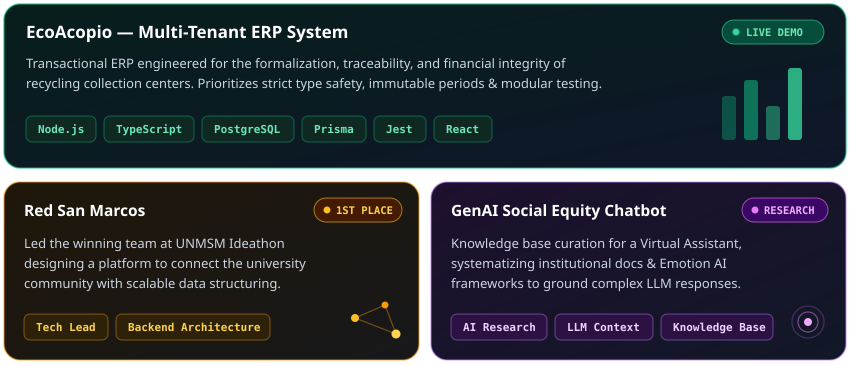

<!-- Banner animado superior -->

  

<!-- Texto dinámico estilo terminal -->

  

<!-- Enlaces Sociales y Contadores -->

  
  
  

 

<!-- Ventana IDE animada (requiere terminal.svg en la raíz) -->

  

 

 

<!-- Tech Stack (Bento Grid SVG) -->
<h3 align="center">⚡ Tech Stack & Architecture</h3>

  

 

 

<!-- Proyectos Destacados (Bento Grid SVG) -->
<h3 align="center">🚀 Featured Projects</h3>

  

  
  

<!-- Dashboard de Estadísticas y Telemetría -->
<h3 align="center">📊 Telemetry & Activity</h3>

  
  

 

<!-- Gráfico de actividad estilo telemetría -->

  

 

<!-- Serpiente animada adaptable a modo oscuro/claro -->

  <picture>
    <source media="(prefers-color-scheme: dark)" srcset="https://raw.githubusercontent.com/SebJoq21/SebJoq21/output/github-contribution-grid-snake-dark.svg" />
    <source media="(prefers-color-scheme: light)" srcset="https://raw.githubusercontent.com/SebJoq21/SebJoq21/output/github-contribution-grid-snake.svg" />
    
  </picture>

 

<!-- Footer animado -->

  

